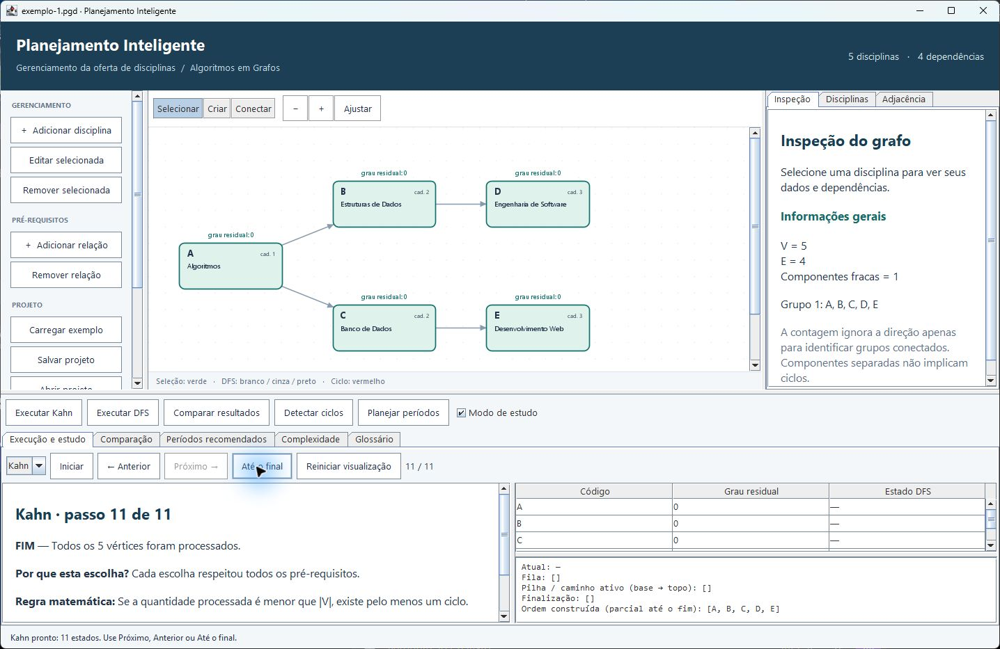
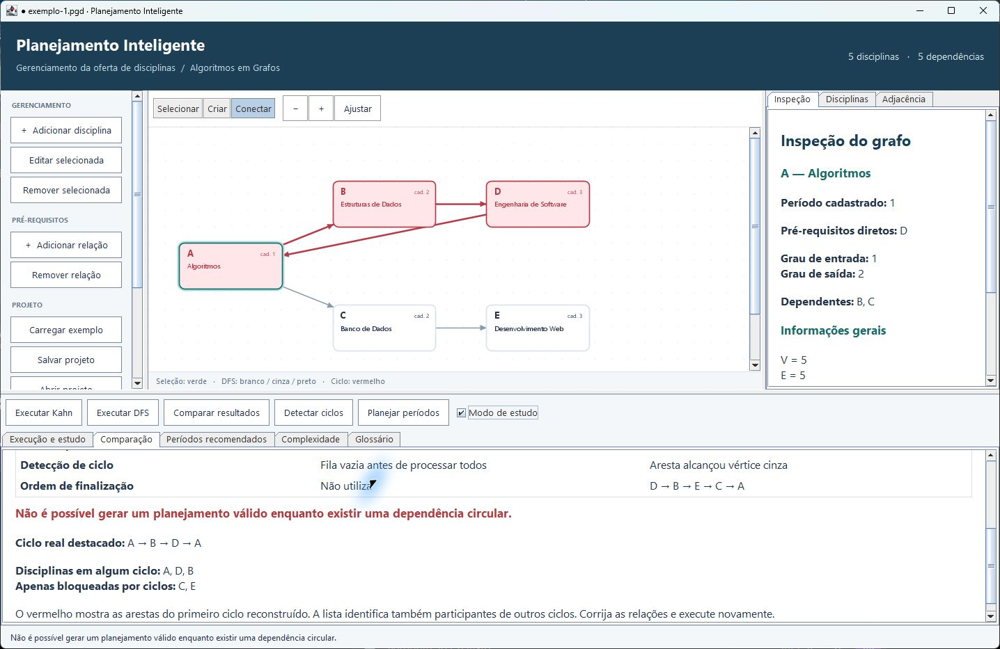

# Planejamento Inteligente para o Gerenciamento da Oferta de Disciplinas

Aplicação acadêmica em **Java 17 e Swing**, sem dependências externas, para construir grafos direcionados de pré-requisitos, estudar Kahn e DFS passo a passo e planejar disciplinas que podem ser cursadas simultaneamente.

**A → B significa que A é pré-requisito de B.** A precisa ser concluída antes de B. A aplicação inicia vazia e permite criar, editar, analisar e salvar os próprios grafos.

Repositório público: [victororex/planejamento-disciplinas-grafos](https://github.com/victororex/planejamento-disciplinas-grafos).

## Capturas reais

Interface Swing executada no Windows durante a validação. As imagens não são mockups.





Veja também a [DFS](docs/capturas/dfs.jpg), a [comparação das ordens válidas](docs/capturas/comparacao.jpg) e o [planejamento simultâneo](docs/capturas/periodos.jpg).

## Executar no Windows

1. Instale um **JDK 17 ou superior**, por exemplo o [Eclipse Temurin oficial](https://adoptium.net/temurin/releases/?version=17&os=windows&arch=x64&package=jdk). Escolha o pacote JDK. Configure `JAVA_HOME` para a pasta do JDK ou adicione sua pasta `bin` ao `PATH`. Consulte as [instruções oficiais para arquivos ZIP](https://adoptium.net/installation/archives).
2. Verifique no terminal: `java -version` e `javac -version`.
3. Abra `executar.bat` com duplo clique. Ele compila o código e abre a janela.

Os scripts também reconhecem um JDK portátil em `.tools/jdk/<pasta-do-jdk>/`. O JDK obtido durante o desenvolvimento fica apenas no ambiente local e **não é versionado nem distribuído**.

No PowerShell, na raiz do projeto:

```powershell
.\compilar.bat
.\executar.bat
.\testar.bat
.\gerar-jar.bat
```

Também é possível compilar diretamente, no PowerShell, Prompt de Comando, Linux ou macOS com um JDK no PATH:

```text
javac -encoding UTF-8 --release 17 -d out src/*.java
java -Dfile.encoding=UTF-8 -cp out Main
java -Dfile.encoding=UTF-8 -cp out TestesAlgoritmos
```

Para iniciar com um projeto salvo: `java -Dfile.encoding=UTF-8 -cp out Main exemplos/exemplo-1.pgd`.

Se o diretório temporário do ambiente for restrito, crie `.tmp` na raiz e execute os testes com `java -Dfile.encoding=UTF-8 -Djava.io.tmpdir=.tmp -cp out TestesAlgoritmos`, como faz `testar.bat`.

Para executar o JAR gerado:

```text
java -Dfile.encoding=UTF-8 -jar dist/planejamento-disciplinas.jar
```

O JAR precisa de Java 17 ou superior. Não é necessário Maven, Gradle, banco de dados, servidor ou acesso à internet para usar o programa. No IntelliJ IDEA, configure o SDK 17 e marque `src` como pasta de fontes; execute `Main` ou `TestesAlgoritmos`.

## Funcionalidades e uso

| Área | Operações |
|---|---|
| Barra esquerda | Cadastro, edição, exclusão, relações, exemplos, salvar, abrir e limpar |
| Centro | Grafo com seleção, arraste, setas direcionadas, zoom e ajuste à área disponível |
| Direita | Disciplina selecionada, período cadastrado, pré-requisitos, graus, cadastro e adjacência |
| Parte inferior | Histórico de execução, comparação, planejamento, complexidade e glossário |

### Construir o grafo

1. Selecione **Criar** e clique numa área vazia; informe código único, nome e período cadastrado. Também há **Adicionar disciplina** na barra lateral (`Ctrl+N`).
2. Selecione **Conectar**; clique primeiro no **pré-requisito**, depois na **disciplina dependente**. A barra de status explica o significado da relação. `Esc` cancela a primeira seleção.
3. Em **Selecionar**, arraste os cartões para organizar o desenho. Um duplo clique abre a edição; o menu de contexto oferece edição e remoção. `Delete` remove a disciplina selecionada após confirmação.
4. A barra esquerda permite adicionar ou remover relações por seletores, sem precisar clicar na aresta. Renomear um código atualiza todas as ligações e a posição. Remover uma disciplina remove as arestas incidentes.
5. Consulte **Inspeção**, **Disciplinas** e **Adjacência** à direita. Nomes longos são abreviados no cartão; o tooltip e a inspeção preservam o nome completo.

**Ciclos são permitidos na edição**, para estudar e corrigir erros. Autodependências, códigos duplicados e relações repetidas são rejeitados. Mover cartões não altera as dependências. Setas terminam na borda arredondada do destino, e relações opostas usam curvas distintas. O zoom também pode ser controlado com `Ctrl` + roda do mouse; barras de rolagem permitem navegar em áreas maiores.

### Estudar Kahn e DFS

Clique em **Executar Kahn**, **Executar DFS** ou escolha o algoritmo e use **Iniciar**. A execução abre no primeiro estado. Use **Próximo**, **Anterior**, **Até o final** e **Reiniciar visualização**. Os estados são cópias imutáveis; voltar não modifica o grafo nem executa operações inversas artificiais.

- **Kahn:** mostra graus residuais, fila FIFO, vértice processado, aresta atualizada e ordem parcial. Cartões amarelos estão na fila; verdes foram processados. O cadastro e suas arestas permanecem intactos.
- **DFS:** mostra branco (não visitado), cinza (ativo) e preto (finalizado), pilha/caminho ativo, aresta explorada, lista de finalização e a ordem invertida no fim. A pilha é exibida da base para o topo. Quadros explícitos simulam as chamadas recursivas.
- **Modo de estudo:** explica o que acontece, a escolha do vértice, a regra matemática, a mudança e o próximo passo usando os códigos, nomes e valores do grafo atual. Pode ser desativado.

O processamento e a leitura/escrita de arquivos ocorrem em `SwingWorker`. Alterações matemáticas invalidam análises anteriores. Durante uma operação, os controles de edição são desativados. O histórico completo é oferecido quando a estimativa `3V + E + 2` não ultrapassa 2000 estados nem 120000 células de estado; acima disso, os resultados finais continuam disponíveis sem histórico para limitar memória. Não há reprodução automática por temporizador: **Até o final** avança diretamente ao resultado.

### Comparar e detectar ciclos

**Comparar resultados** apresenta Kahn e DFS lado a lado: estratégia, estrutura auxiliar, ordem, verificação independente, quantidade processada, ciclos e finalização. **Duas ordenações diferentes podem estar corretas**. O verificador exige cada vértice exatamente uma vez e, para toda aresta A → B, `posição(A) < posição(B)`.

**Detectar ciclos** mostra um caminho real reconstruído na pilha da DFS, como `A → B → C → A`, e destaca suas arestas em vermelho. A lista de participantes de qualquer ciclo é obtida por componentes fortemente conexas; disciplinas apenas bloqueadas são apresentadas separadamente. O resíduo de Kahn **não** é confundido com o conjunto de participantes do ciclo. A ordem parcial de Kahn e a finalização DFS de um grafo cíclico nunca são aceitas como ordenação válida. Corrija a ligação na barra esquerda e execute novamente.

### Planejar períodos

**Planejar períodos** mostra colunas de **etapas recomendadas** com os pré-requisitos de cada disciplina. Os cartões do grafo passam a mostrar essas etapas.

```text
etapa(v) = 1                                      se v não tem pré-requisitos
etapa(v) = 1 + máximo(etapa(p)), para cada p → v    caso contrário
```

Não há agrupamento arbitrário da ordem. As dependências são propagadas em ordem topológica; todos os pré-requisitos ficam em etapas anteriores. Com ciclos, o planejamento é bloqueado. O **período cadastrado** permanece como dado acadêmico independente e não é reescrito pelo algoritmo.

O modelo considera apenas dependências, sem limite de disciplinas simultâneas, duração variável, carga horária, vagas ou conflitos de horários. A etapa é a mais cedo possível nessa hipótese; não é uma previsão completa da oferta real de uma universidade.

### Salvar e abrir

**Salvar projeto** (`Ctrl+S`) grava `.pgd`; **Abrir projeto** (`Ctrl+O`) valida e recupera disciplinas, relações e posições. Um arquivo inválido não substitui o projeto atual. Há confirmação antes de sobrescrever um arquivo ou descartar alterações. O [formato textual PGD 1](docs/FORMATO-PGD.md) usa UTF-8 e Base64 para os textos, sem bibliotecas externas. Resultados de execução não são persistidos.

## Exemplos editáveis

Os quatro exemplos estão no seletor **Carregar exemplo** e em `exemplos/*.pgd`.

| Exemplo | Dependências | Resultados |
|---|---|---|
| 1 — DAG acadêmico | A → B, A → C, B → D, C → E | Kahn: A B C D E; DFS: A C E B D; etapas: A / B,C / D,E |
| 2 — Múltiplas ordens | A → B, M → C, B → D, C → D | Kahn: A M B C D; DFS: M C A B D; ambas válidas |
| 3 — Circular | A → B, B → C, C → A | Ambos detectam ciclo; planejamento indisponível |
| 4 — Componentes | A → B, M → F; I isolada | Três componentes fracas e ordenação válida |

Para recriar os arquivos após compilar: `java -Dfile.encoding=UTF-8 -cp out ExemplosAcademicos`.

## Estrutura e responsabilidades

```text
src/                    Fontes Java (pacote padrão)
exemplos/               Quatro projetos PGD totalmente editáveis
docs/RELATORIO.md        Relatório acadêmico
docs/FORMATO-PGD.md      Especificação da persistência
docs/VALIDACAO.md        Evidências e roteiro de apresentação
docs/resultado-testes.txt Saída real do executor de testes
docs/PUBLICACAO.md       Instruções e status do GitHub
scripts/java-env.bat     Localização do JDK
compilar.bat            Compilar com Java 17
executar.bat            Compilar e abrir a aplicação
testar.bat              Compilar e testar
gerar-jar.bat            Gerar JAR executável
LICENSE                 Licença MIT
```

| Classes | Responsabilidade |
|---|---|
| `Disciplina` | Cadastro imutável e validações de código, nome e período |
| `GrafoDisciplinas` | Lista de adjacência, CRUD, pré-requisitos derivados, graus, cópias e componentes fracas |
| `AlgoritmoKahn`, `AlgoritmoDFS` | Implementações manuais, com observador opcional de passos |
| `ResultadoOrdenacao`, `PassoAlgoritmo` | Resultados e estados imutáveis |
| `DetectorCiclos` | Ciclo testemunha da DFS e classificação de participantes por Kosaraju |
| `PlanejadorPeriodos` | Etapas mínimas por dependências, sem restrições adicionais |
| `ComparadorAlgoritmos` | Execuções e verificador independente de permutação e arestas |
| `VerticeVisual`, `ProjetoAcademico` | Posições separadas do grafo e agregação para persistência |
| `GerenciadorArquivos`, `ExemplosAcademicos` | Arquivos seguros e exemplos |
| `TelaPrincipal`, `PainelGrafo`, `Tema`, `Main` | Interface, interação, geometria, aparência e inicialização |
| `ExplicadorDidatico` | Textos educativos e proteção de conteúdo HTML |
| `TestesAlgoritmos` | Testes com biblioteca padrão; falhas geram saída de erro do processo |

Os pré-requisitos de uma disciplina são consultados por `grafo.obterPrerequisitos(codigo)`. Eles não são duplicados em uma lista mutável dentro de `Disciplina`: a adjacência é a única fonte das relações, evitando divergências entre cadastro e grafo.

## Algoritmos e complexidade

O modelo usa `LinkedHashMap<String, Set<String>>` com conjuntos `LinkedHashSet`. A ordem de cadastro e de inserção de arestas torna as execuções determinísticas, sem ordenações lexicográficas adicionais.

| Operação | Tempo | Estado auxiliar de trabalho |
|---|---|---|
| Kahn | O(V + E) | O(V): graus, fila e resultado |
| DFS | O(V + E) | O(V): cores, pilha e finalização |
| Verificação da ordem | O(V + E) | O(V): posições |
| Planejamento | O(V + E) | O(V): etapas e grupos |
| Classificação de ciclos por Kosaraju | O(V + E) | O(V + E): transposto e visita |

As operações de mapas/conjuntos têm custo médio O(1). Kahn percorre cada aresta para contar graus e novamente ao processar a origem. A DFS visita cada vértice e examina cada aresta uma vez. A implementação obtém uma **cópia segura da adjacência** para executar: essa cópia acrescenta O(V + E) de memória, embora o estado essencial dos algoritmos seja O(V).

Guardar T fotografias completas custa O(T·V), além dos textos. Histórico, renderização, layout, tempo de leitura e interação não são confundidos com o custo teórico das ordenações. Consultas isoladas de pré-requisitos varrem a adjacência; os algoritmos não repetem essa consulta para cada vértice.

## Testes e relatório

Foram executados **50 testes, com 0 falhas**, no JDK Temurin 17.0.20.1. A suíte inclui os 20 tópicos obrigatórios, entradas inválidas, edição de códigos, classificação de múltiplos ciclos, imutabilidade dos estados, geometria das extremidades, 100 DAGs aleatórios, 40 grafos com conferência independente por alcançabilidade e uma cadeia de 10000 vértices. São 50 casos nomeados; as amostras aleatórias são verificações internas, não 140 casos extras na contagem.

Consulte a [saída real](docs/resultado-testes.txt), as [evidências e o roteiro da interface](docs/VALIDACAO.md), o [relatório acadêmico](docs/RELATORIO.md) e as [instruções de publicação](docs/PUBLICACAO.md).

## Referências acadêmicas e licença

Enunciado e tópicos indicados pela professora **Silvia Brandão**: Projeto Prático 1 — Algoritmos em Grafos; Aula 7 — Contagem de Componentes Conexos; Aula 8 — Ordenação Topológica; Aula 9 — Detecção de Ciclos. Os PDFs não estavam disponíveis no workspace; a implementação e o relatório se baseiam nos requisitos textuais fornecidos. Não se afirma revisão direta dos PDFs, e nenhum material da professora é redistribuído.

Código sob a [licença MIT](LICENSE). A identificação da licença foi obtida do perfil autenticado do GitHub. Nenhum nome, RA ou identificação de aluno foi acrescentado ao relatório acadêmico.
